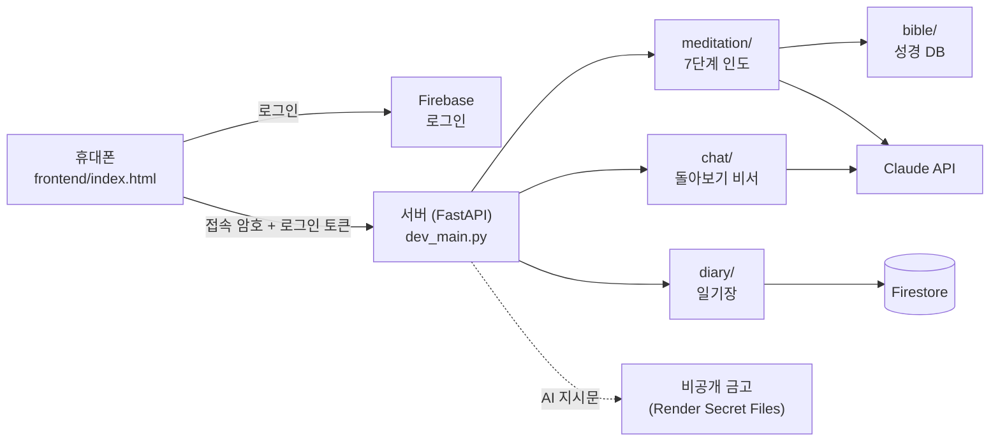

# Diary with Jesus

성경이 낯선 사람도 "나도 묵상할 수 있구나"를 느끼도록, AI 인도자가 곁에 앉아 7단계로 함께 묵상하는 휴대폰 일기장이다.

- 질문하며 본문을 스스로 보게 하는 **귀납적 성경 묵상(IBS)**을 대화로 인도한다.
- 묵상이 끝나면 대화를 **일기 한 편**으로 정리해 사용자별 일기장에 저장한다.
- 쌓인 묵상을 책 단위, 기간 단위로 **돌아보는 비서**가 있다.

## 화면의 흐름

1. **책 표지를 펼친다.** Google 계정으로 로그인한다.
2. **달력**이 나온다. 묵상한 날에는 그날의 본문이 적혀 있고, 누르면 그날의 일기가 열린다.
3. **오늘을 누른다.** 읽던 책에서 이어지는 본문이 한 단락만큼 골라져 나온다. 끝 절을 바꾸거나 다른 본문을 직접 적을 수도 있다.
4. **7단계 묵상**을 한다.
   시작 기도 → 본문 읽기 → 관찰 → 배경 → 해석 → 진리 → 적용과 마침 기도
   인도자는 답을 대신 주지 않는다. 기도는 평가하지 않고 그대로 받고, 진리는 묵상자가 자기 문장으로 쓴다.
5. **정리하고 저장한다.** 대화가 일기 한 편으로 정리되고, 저장하면 달력으로 돌아온다.
6. **돌아본다.** 달력 아래 칸에 "골로새서에서 찾은 진리를 보여 줘", "올해 어떤 책을 묵상했지?"처럼 물으면 비서가 저장된 묵상을 찾아 답한다.

묵상을 중간에 멈추어도 다시 열면 이어서 할 수 있다.

## 구조



| 자리 | 하는 일 |
| --- | --- |
| `frontend/` | 휴대폰 화면 한 장(`index.html`)과 홈 화면 아이콘 |
| `dev_main.py` | 앱의 출입구. 세 부분을 연결하고, 접속 암호를 확인한다 |
| `meditation/` | 7단계 묵상 인도, 끝났는지 확인, 일기로 정리 |
| `chat/` | 돌아보기 비서. 저장된 묵상을 도구로 찾아 읽고 답한다 |
| `diary/` | 일기장. 로그인한 사람의 묵상만 Firestore에 읽고 쓴다 |
| `bible/` | 본문 조회와 성경 DB 검사 (읽기만 한다) |
| `prompts/` | AI 지시문의 자리. 비어 있다 ([아래](#보안-설계) 참고) |
| `settings.py` | `.env` 읽기, AI 지시문 찾기 |
| `tools/` | 예전 묵상 기록을 지금의 구조에 맞추는 도구 |
| `tests/` | 검사 |

## 보안 설계

공개 저장소이므로, 지켜야 할 것은 코드 밖에 둔다.

| 지키는 것 | 어디에 두었나 | 어떻게 지키나 |
| --- | --- | --- |
| Claude API 키, Firebase 서비스 계정 키 | 서버 환경변수 | 저장소에 올리지 않는다 (`.env`는 `.gitignore`) |
| **AI 지시문(인도법)** | 비공개 저장소 + 서버의 Secret Files | 저장소에는 자리만 있다. 서버는 `/etc/secrets/`에서 읽는다 |
| API 요금 | 접속 암호 `APP_PASSCODE` | 암호 없이는 `/api/`를 부를 수 없다 |
| 각자의 일기 | Firestore | 화면은 Firestore에 직접 가지 않는다. 서버가 로그인 토큰으로 누구인지 확인하고 그 사람의 묵상만 읽고 쓴다 |

**AI 지시문을 공개하지 않는 이유.** 인도자가 어떻게 묻고, 언제 기다리고, 언제 넘어가는지가 이 앱의 중심이고, 오랫동안 다듬어 온 것이다. 그래서 코드는 공개하되 지시문은 따로 지킨다. 서버는 `settings.read_prompt()` 한 곳에서 지시문을 찾고, 없으면 무엇이 빠졌는지 분명히 알린다 (`prompts/README.md`).

화면이 쓰는 Firebase 웹 설정(`FIREBASE_WEB_CONFIG`)은 원래 공개되는 값이다. 진짜 자물쇠는 서버의 로그인 확인이다.

## 내 컴퓨터에서 실행하기

1. 이 저장소를 내려받는다.
2. 터미널에서 `sh setup.sh`를 실행한다. 가상환경을 만들고 패키지를 설치하고 `.env`를 준비한다.
3. `.env`를 열어 `ANTHROPIC_API_KEY=` 뒤에 API 키를 넣는다. 다른 값은 `.env.example`의 설명을 따른다.
4. AI 지시문 다섯 파일을 `prompts/` 폴더에 넣는다. 이 폴더의 파일은 Git에 올라가지 않는다.
5. `sh run.sh`로 켜고 http://127.0.0.1:8000 을 연다. 끌 때는 `Ctrl + C`.

일기장 환경변수(`FIREBASE_SERVICE_ACCOUNT`, `FIREBASE_WEB_CONFIG`)를 비워 두면 일기장은 꺼지고, 묵상 기록은 기기에만 보관된다.

## 배포

[Render](https://render.com)의 Web Service로 이 저장소의 `main`을 연결한다.

| 항목 | 값 |
| --- | --- |
| Build Command | `pip install -r requirements.txt` |
| Start Command | `uvicorn dev_main:app --host 0.0.0.0 --port $PORT` |
| Environment | `ANTHROPIC_API_KEY`, `APP_PASSCODE`, `FIREBASE_SERVICE_ACCOUNT`, `FIREBASE_WEB_CONFIG` |
| Secret Files | AI 지시문 다섯 파일 (`prompts/README.md`의 이름 그대로) |

`main`에 합치면 Render가 자동으로 다시 배포한다. 화면(`frontend/`)은 Vercel로 옮길 예정이다.

## 일기장 (Firestore)

- `diaries/{기록 번호}`: 묵상 한 편. 모든 문서가 같은 19개 항목을 가진다: 기록 17개(`diary/schema.py`) + `uid` + `deleted`.
- `diary_state/{uid}`: 읽던 책의 자리, 하다가 멈춘 묵상.
- 묵상은 새로 만들기만 하고, 다른 내용으로 덮어쓰지 않는다. 지우기는 "지움" 표시만 한다.
- 예전 구조(11개 항목)의 묵상은 `tools/diaries.py`로 맞춘다. `--apply` 없이는 아무것도 바꾸지 않고, 바꿀 때는 먼저 사본을 받아 대조한다.

## 검사

```
.venv/bin/python -m tests.test_bible
.venv/bin/python -m tests.test_meditation
.venv/bin/python -m tests.test_chat
.venv/bin/python -m tests.test_diary
.venv/bin/python -m tests.test_passcode
```

AI를 실제로 부르지 않고, 흉내 낸 답으로 대화 흐름과 기록의 모양을 확인한다.

## 사용한 것

- Python, FastAPI, Uvicorn
- Claude API (Anthropic): 묵상 인도, 일기 정리, 돌아보기 비서
- Firebase Authentication (Google 로그인), Cloud Firestore
- Render (서버 배포)
- 성경 본문: 『성경전서 개역한글판』 (대한성서공회). 저작권 사용 허가 없이 쓸 수 있는 판본이다.
